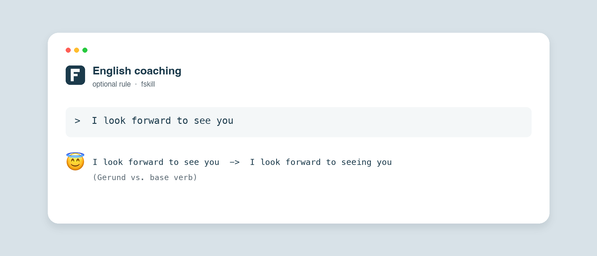

<div align="center">
  
  <h1>fskill</h1>
  <p><b>gofenix's engineering habits, turned into your skills.</b></p>
  <p>English · <a href="README_CN.md">中文</a> · <a href="README_TW.md">繁體</a> · <a href="README_JA.md">日本語</a> · <a href="README_KR.md">한국어</a> · <a href="README_DE.md">Deutsch</a> · <a href="README_FR.md">Français</a></p>
  <a href="https://github.com/gofenix/fskill/actions/workflows/test.yml"></a>
  <a href="https://github.com/gofenix/fskill/stargazers"></a>
  <a href="https://github.com/gofenix/fskill/releases"></a>
  <a href="LICENSE"></a>
  <a href="https://twitter.com/Higofenix"></a>
</div>

<br/>

## Skills

fskill pairs **9 lean workflow skills** with **8 `pstack`-style engineering principles** and deterministic helper scripts. Start any workflow with `/name` or `$name`. `think`, `hunt`, and `check` also activate automatically when the task calls for them; the other six stay explicit-only. Refined from [tw93/Waza](https://github.com/tw93/Waza), [Matt Pocock skills](https://github.com/mattpocock/skills), and [pstack](https://github.com/cursor/plugins/tree/main/pstack).

| Skill | When | What it does |
| :--- | :--- | :--- |
| [`/f-mode`](skills/f-mode/SKILL.md) | Route | Enter explicitly, then select one workflow below and consult shared engineering principles. |
| [`/think`](skills/think/SKILL.md) | Decide | Pre-implementation plan, value judgment (`Drop/Keep/Pivot`), scope triage, prompt reframing/sharpening, and `grill me` pressure testing. |
| [`/hunt`](skills/hunt/SKILL.md) | Find the problem | Root-cause debugging with runtime evidence, plus single-hypothesis metric optimization. |
| [`/check`](skills/check/SKILL.md) | Review | Evidence-backed diff/PR review, release judgment, audit signals, and incident replay. |
| [`/ui`](skills/ui/SKILL.md) | Interface | Distinctive, non-slop frontend UI design, motion, and real-render verification (explicit call). |
| [`/learn`](skills/learn/SKILL.md) [`/write`](skills/write/SKILL.md) | Read and write | Fetch one URL/PDF or synthesize primary sources; de-AI prose and release notes (explicit call). |
| [`/handoff`](skills/handoff/SKILL.md) [`/health`](skills/health/SKILL.md) | Keep | Compact session handoff, agent config/hooks/MCP/token-tool audits, and rule pruning (explicit call). |

**8 engineering principles ([`rules/principles.md`](rules/principles.md), bundled in [`f-mode`](skills/f-mode/references/principles.md)):** Subtract before you add · Attack the premise · Fix root causes · Prove it works · Test behavior · Explain the number · Encode lessons in structure · Respect boundaries

Enter `/f-mode` (Codex: `$f-mode`; plugin: `/fskill:f-mode`) once, then describe your tasks normally. It routes within this session until `/f-mode off`; `/f-mode status` reports state. Direct commands such as `/hunt` take priority without closing f-mode. New sessions start off. Mode selects workflows, not action permissions. See [skills/RESOLVER.md](skills/RESOLVER.md) for the full trigger map.

## Install

**Claude Code, Codex, Cursor, and other agents**

```bash
npx skills add gofenix/fskill -a claude-code codex cursor -g -y
```

One copy lands in `~/.agents/skills`, the shared skills directory. Claude Code is symlinked in; Codex, Cursor, Gemini CLI, Copilot, Amp, Kimi Code CLI, and every other agent that reads that directory picks up the 9 workflow skills. Explicit-only workflows start only on `/ui`, `$ui`, or inside `/f-mode`. Agents with a private skills directory take their id after `-a` (for example `antigravity-cli` or `qwen-code`). Update with `npx skills update -g -y`. You can also tell your agent to install it:
> Install fskill for me by reading https://github.com/gofenix/fskill/blob/main/llms.txt

**Host plugin**, if you prefer the host's own update command (skills are namespaced, `/fskill:check`)

```bash
# Claude Code (update: claude plugin update fskill)
/plugin marketplace add gofenix/fskill
/plugin install fskill@fskill

# Codex (update: codex plugin marketplace upgrade fskill, then codex plugin add fskill@fskill)
codex plugin marketplace add gofenix/fskill
codex plugin add fskill@fskill
```

**Claude Desktop**: download [fskill.zip](https://github.com/gofenix/fskill/releases/latest/download/fskill.zip), open Customize > Skills > "+" > Create skill, and upload the ZIP. To update, click "..." on the skill card, choose Replace, and upload the latest ZIP.

**Pi**: `pi install npm:@gofenix/fskill`, update with `pi update npm:@gofenix/fskill`.

## Chaining Skills

Outside f-mode, you decide the order. Each skill stops when its outcome is done. Call the next one with `/name` or `$name`.

**Common workflows:**

- **Plan a feature**: `/think` settles the plan cleanly (subtract before you add). After approval, the current agent implements it, then `/check` reviews before merging.
- **Ship a fix**: `/hunt` proves the root cause with runtime evidence, fix cleanly, then `/check` reviews and validates release evidence.
- **Research and write**: `/learn` fetches a URL/PDF or synthesizes primary sources, `/write` polishes the prose.

## Project Context

fskill ships only generic engineering workflows, concise principles, and deterministic scripts. `/check` becomes project-aware at runtime by reading the target repository's public context (READMEs, package manifests, Makefiles, CI workflows) and your task constraints, never private paths, credentials, or tokens. See [`skills/check/references/review-patterns.md`](skills/check/references/review-patterns.md) and [`skills/check/references/release-artifacts.md`](skills/check/references/release-artifacts.md).

## Extras

Curl URLs use the latest GitHub release asset. Set `FSKILL_REF=main` before the command if you want bleeding-edge scripts.

### Statusline

A minimal statusline for Claude Code: context window, 5-hour quota, and 7-day quota. Color-coded by usage, no progress bars, no noise.

<div align="center">
  
</div>

```bash
(
  set -e
  FSKILL_STATUSLINE_SCRIPT="$(mktemp -t fskill-statusline.XXXXXX)"
  trap 'rm -f "$FSKILL_STATUSLINE_SCRIPT"' EXIT
  curl -fL https://github.com/gofenix/fskill/releases/latest/download/setup-statusline.sh -o "$FSKILL_STATUSLINE_SCRIPT"
  # review it first: less "$FSKILL_STATUSLINE_SCRIPT"
  bash "$FSKILL_STATUSLINE_SCRIPT"
)
```

**Codex** has native statusline items. Add to `~/.codex/config.toml`:

```toml
[tui]
status_line = ["model-with-reasoning", "current-dir", "context-used", "five-hour-limit", "weekly-limit"]
status_line_use_colors = true
```

Codex shows remaining quota; the Claude Code statusline above shows used percentage (upstream does not yet expose `five-hour-used` / `weekly-used`).

### Optional Rules

Optional rules apply beyond skill invocations when installed into your agent's persistent instructions. Installing fskill skills alone does not enable them. Copy the ones you want (swap `claude-code` for `codex` or `antigravity-cli` on those agents):

```bash
(
  set -e
  FSKILL_RULE_SCRIPT="$(mktemp -t fskill-rule.XXXXXX)"
  trap 'rm -f "$FSKILL_RULE_SCRIPT"' EXIT
  curl -fL https://github.com/gofenix/fskill/releases/latest/download/setup-rule.sh -o "$FSKILL_RULE_SCRIPT"
  # review it first: less "$FSKILL_RULE_SCRIPT"

  # English coaching: appends a short 😇 correction when your prompt has an English mistake
  bash "$FSKILL_RULE_SCRIPT" english claude-code

  # Anti-patterns: always-on cross-skill guardrails (read before acting, no scope creep, no unsolicited summaries)
  bash "$FSKILL_RULE_SCRIPT" anti-patterns claude-code

  # Routing hint: think/hunt/check may auto-enter on matching tasks; explicit commands for the rest, goal-based routing inside /f-mode
  bash "$FSKILL_RULE_SCRIPT" fskill-routing claude-code

  # Engineering principles: 8 concise pstack-style invariants without adding skill folders
  # Principles is available on main; it is not in the current release yet.
  FSKILL_REF=main bash "$FSKILL_RULE_SCRIPT" principles claude-code

  # Clear everyday replies: consistent terms, explicit conditions, preserved uncertainty
  # Clarity is available on main; it is not in the current release yet.
  FSKILL_REF=main bash "$FSKILL_RULE_SCRIPT" clarity claude-code
)
```

<div align="center">
  
</div>

[Clarity](rules/clarity.md) uses clear-writing principles from ASD-STE100 without imposing controlled-English grammar or changing your voice. Re-run its command to update the installed rule, then start a new session. Codex installs a marked block in `~/.codex/AGENTS.md`; Claude Code and Antigravity install a rule file. For other tools, copy the rule into their persistent custom instructions.

## Why

fskill is gofenix's skill set, built from [tw93/Waza](https://github.com/tw93/Waza)'s tooling and [pstack](https://github.com/cursor/plugins/tree/main/pstack)'s principle-first design. Instead of bloating contexts with textbook multi-file SOPs that frontier models already know, it keeps **9 lean workflows** (`f-mode`, `think`, `hunt`, `check`, `ui`, `learn`, `write`, `handoff`, `health`), concise shared engineering principles in [`rules/principles.md`](rules/principles.md), and deterministic scripts for checks models shouldn't guess.

Enter any skill with `/name` or `$name`. `think`, `hunt`, and `check` trigger on matching tasks; the other six wait for an explicit call.

## Uninstall

```bash
npx skills remove gofenix/fskill -g
rm -f ~/.claude/statusline.sh
rm -f ~/.claude/rules/english.md
rm -f ~/.claude/rules/anti-patterns.md
rm -f ~/.claude/rules/fskill-routing.md
rm -f ~/.claude/rules/principles.md
rm -f ~/.claude/rules/clarity.md
```

For the statusline, also remove the `statusLine` entry from `~/.claude/settings.json`. For Claude Desktop, delete fskill from Customize > Skills. For Codex rule installs, remove the marked fskill blocks from `~/.codex/AGENTS.md`. For Antigravity, remove the selected rule file from `~/.gemini/antigravity-cli/rules/`. Remove copied rules from other tools' custom instructions. Start a new session after removing a rule.

## Support

If fskill helped, star the repo or open an issue.

## License

MIT, with Apache-2.0 material in the UI references. Thanks to [Waza](https://github.com/tw93/Waza), [Matt Pocock skills](https://github.com/mattpocock/skills), and [pstack](https://github.com/cursor/plugins/tree/main/pstack). UI methods also adapt [Impeccable](https://github.com/pbakaus/impeccable), [taste-skill](https://github.com/Leonxlnx/taste-skill), and [apple-design](https://github.com/emilkowalski/skills). The root [LICENSE](LICENSE) preserves source revisions, modification notices, and full license terms. gofenix's notice covers original additions and modifications; upstream notices cover their respective reused material.
