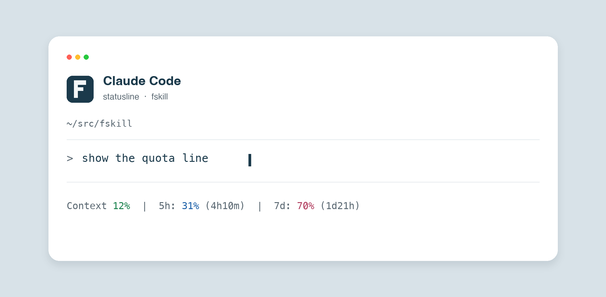

<div align="center">
  
  <h1>fskill</h1>
  <p><b>gofenixs Entwicklergewohnheiten, als Skills für deine Agenten</b></p>
  <p><a href="README.md">English</a> · <a href="README_CN.md">中文</a> · <a href="README_TW.md">繁體</a> · <a href="README_JA.md">日本語</a> · <a href="README_KR.md">한국어</a> · Deutsch · <a href="README_FR.md">Français</a></p>
  <a href="https://github.com/gofenix/fskill/actions/workflows/test.yml"></a>
  <a href="https://github.com/gofenix/fskill/stargazers"></a>
  <a href="https://github.com/gofenix/fskill/releases"></a>
  <a href="LICENSE"></a>
  <a href="https://twitter.com/Higofenix"></a>
</div>

<br/>

## Skills

fskill verbindet **9 schlanke Workflow-Skills**, **8 Engineering-Prinzipien im Stil von `pstack`** und deterministische Skripte. Jeder Skill startet per `/name` oder `$name`; `think`, `hunt` und `check` greifen bei passender Aufgabe automatisch, die übrigen sechs nur nach ausdrücklichem Aufruf oder im aktiven `/f-mode`. Abgeleitet aus [Waza](https://github.com/tw93/Waza), [Matt Pocock skills](https://github.com/mattpocock/skills) und [pstack](https://github.com/cursor/plugins/tree/main/pstack).

| Skill | Gruppe | Was er tut |
| :--- | :--- | :--- |
| [`/f-mode`](skills/f-mode/SKILL.md) | Route | Ausdrücklich aktivieren, um je nach Ziel den passenden Workflow mit gemeinsamen Prinzipien zu wählen. |
| [`/think`](skills/think/SKILL.md) | Richtung | Planung vorab, Werturteil (`Drop/Keep/Pivot`), Scope-Triage und `grill me`. |
| [`/hunt`](skills/hunt/SKILL.md) | Problem finden | Ursachenanalyse mit Laufzeitbeleg sowie Einzelhypothesen-Optimierung für feste Metriken. |
| [`/check`](skills/check/SKILL.md) | Prüfen | Evidenzbasierter Diff-/PR-Review, Release-Bewertung, Projekt-Audit und Incident-Replay. |
| [`/ui`](skills/ui/SKILL.md) | Oberfläche | Eigenständige, slop-freie UI, Motion und echte Render-Prüfung (ausdrücklicher Aufruf). |
| [`/learn`](skills/learn/SKILL.md) [`/write`](skills/write/SKILL.md) | Lesen und schreiben | URL/PDF abrufen, Primärquellen verdichten; AI-Ton und Release Notes glätten (ausdrücklicher Aufruf). |
| [`/handoff`](skills/handoff/SKILL.md) [`/health`](skills/health/SKILL.md) | Wiederverwenden | Kompakte Übergabe sowie deterministisches Audit für Agent-Konfig, Hooks/MCP und Regel-Pruning (ausdrücklicher Aufruf). |

**8 Engineering-Prinzipien ([`rules/principles.md`](rules/principles.md), eingebettet in [`f-mode`](skills/f-mode/references/principles.md)):** Erst kürzen, dann ergänzen · Prämisse angreifen · Grundursache beweisen · Echt verifizieren · Verhalten testen · Zahlen erklären · In Struktur verankern · Grenzen und Einbahnstraßen achten

Mit `/f-mode` (Codex: `$f-mode`, Plugin: `/fskill:f-mode`) starten und Aufgaben normal beschreiben. Die Auswahl bleibt in dieser Sitzung bis `/f-mode off` aktiv. `/f-mode status` zeigt den Zustand. Direkte Befehle haben Vorrang und lassen f-mode aktiv. Neue Sitzungen starten ohne f-mode. Aktionsberechtigungen bleiben unverändert. Vollständiges Routing: [skills/RESOLVER.md](skills/RESOLVER.md).

## Installation

**Claude Code, Codex, Cursor und andere Agenten**

```bash
npx skills add gofenix/fskill -a claude-code codex cursor -g -y
```

Skills landen zentral in `~/.agents/skills`. Claude Code bindet sie per Symlink ein; Codex, Cursor, Gemini CLI, Copilot, Amp, Kimi Code CLI und alle Agenten, die dieses Verzeichnis nutzen, laden die 9 Workflows. Explizite Workflows starten nur über `/ui`, `$ui` oder im `/f-mode`. Agenten mit eigenem Skill-Verzeichnis gibst du nach `-a` mit ihrer ID an (zum Beispiel `antigravity-cli` oder `qwen-code`). Aktualisierung über `npx skills update -g -y`. Du kannst deinen Agenten auch direkt mit der Installation beauftragen:
> Lies https://github.com/gofenix/fskill/blob/main/llms.txt und installiere fskill für mich

**Host-Plugin-Methode** (Skills erhalten ein Namespace-Präfix, z. B. `/fskill:check`):

```bash
# Claude Code (Update: claude plugin update fskill)
/plugin marketplace add gofenix/fskill
/plugin install fskill@fskill

# Codex (Update: codex plugin marketplace upgrade fskill, dann codex plugin add fskill@fskill)
codex plugin marketplace add gofenix/fskill
codex plugin add fskill@fskill
```

**Claude Desktop**: Lade [fskill.zip](https://github.com/gofenix/fskill/releases/latest/download/fskill.zip) herunter, öffne Customize > Skills > "+" > Create skill und lade die ZIP-Datei hoch. Zum Aktualisieren klickst du auf der Skill-Karte auf "...", wählst Replace und lädst die neueste ZIP-Datei hoch.

**Pi**: `pi install npm:@gofenix/fskill`, Update über `pi update npm:@gofenix/fskill`.

## Skill-Kombinationen

Außerhalb von f-mode bestimmst du die Reihenfolge. Jeder Skill stoppt, wenn sein Ergebnis da ist. Den nächsten rufst du mit `/name` oder `$name` auf.

**Typische Workflows:**

- **Neues Feature**: `/think` schärft den Plan (erst kürzen, dann ergänzen). Nach Freigabe setzt der aktuelle Agent um, danach prüft `/check`.
- **Bugfix**: `/hunt` beweist die Grundursache mit Laufzeitbelegen, Behebung, danach Prüfung und Release-Evidenz über `/check`.
- **Recherche**: `/learn` liest URL/PDF oder Primärquellen, `/write` formuliert aus.

## Projekt-Kontext

fskill liefert nur universelle Prinzipien und Hilfsskripte. `/check` liest zur Laufzeit öffentliche Projektdateien (README, Paketdefinitionen, Makefile, CI-Workflows) und deine Vorgaben, niemals private Pfade, Zugangsdaten oder Tokens. Siehe [`skills/check/references/review-patterns.md`](skills/check/references/review-patterns.md) und [`skills/check/references/release-artifacts.md`](skills/check/references/release-artifacts.md).

## Extras

Die curl-URLs verwenden das neueste GitHub-Release-Asset. Für die neuesten Skripte von main setzt du `FSKILL_REF=main` vor den Befehl.

### Statusleiste

Minimale Statusleiste für Claude Code: Kontext-Window, 5-Stunden- und 7-Tage-Kontingente farbcodiert, ohne Fortschrittsbalken und ohne Ablenkung.

<div align="center">
  
</div>

```bash
(
  set -e
  FSKILL_STATUSLINE_SCRIPT="$(mktemp -t fskill-statusline.XXXXXX)"
  trap 'rm -f "$FSKILL_STATUSLINE_SCRIPT"' EXIT
  curl -fL https://github.com/gofenix/fskill/releases/latest/download/setup-statusline.sh -o "$FSKILL_STATUSLINE_SCRIPT"
  # vorher prüfen: less "$FSKILL_STATUSLINE_SCRIPT"
  bash "$FSKILL_STATUSLINE_SCRIPT"
)
```

**Codex**-Statuszeile in `~/.codex/config.toml`:

```toml
[tui]
status_line = ["model-with-reasoning", "current-dir", "context-used", "five-hour-limit", "weekly-limit"]
status_line_use_colors = true
```

Codex zeigt das verbleibende Kontingent, die Claude-Code-Statusleiste oben den verbrauchten Anteil (upstream gibt es `five-hour-used` / `weekly-used` noch nicht).

### Optionale Regeln

Optionale Regeln wirken auch außerhalb von Skill-Aufrufen, sobald sie in den dauerhaften Anweisungen deines Agenten installiert sind. Die Installation der fskill-Skills allein aktiviert sie nicht. Kopiere die gewünschten Befehle (bei Codex oder Antigravity ersetzt du `claude-code` durch `codex` bzw. `antigravity-cli`):

```bash
(
  set -e
  FSKILL_RULE_SCRIPT="$(mktemp -t fskill-rule.XXXXXX)"
  trap 'rm -f "$FSKILL_RULE_SCRIPT"' EXIT
  curl -fL https://github.com/gofenix/fskill/releases/latest/download/setup-rule.sh -o "$FSKILL_RULE_SCRIPT"
  # vorher prüfen: less "$FSKILL_RULE_SCRIPT"

  # Englisch-Coaching: hängt eine kurze 😇-Korrektur an, wenn dein Prompt einen Englischfehler enthält
  bash "$FSKILL_RULE_SCRIPT" english claude-code

  # Anti-Patterns: stets aktive, skillübergreifende Leitplanken (erst lesen, dann handeln; kein Scope Creep; keine ungefragten Zusammenfassungen)
  bash "$FSKILL_RULE_SCRIPT" anti-patterns claude-code

  # Routing-Hinweis: think/hunt/check starten bei passender Aufgabe selbst, die übrigen auf ausdrücklichen Aufruf
  bash "$FSKILL_RULE_SCRIPT" fskill-routing claude-code

  # Engineering-Prinzipien: 8 knappe Invarianten ohne zusätzliche Skill-Ordner
  # Principles ist auf main verfügbar, aber noch nicht im aktuellen Release
  FSKILL_REF=main bash "$FSKILL_RULE_SCRIPT" principles claude-code

  # Klare Alltagsantworten: einheitliche Begriffe, explizite Bedingungen, Unsicherheit bleibt erhalten
  # Clarity ist auf main verfügbar, aber noch nicht im aktuellen Release
  FSKILL_REF=main bash "$FSKILL_RULE_SCRIPT" clarity claude-code
)
```

<div align="center">
  
</div>

[Clarity](rules/clarity.md) übernimmt Prinzipien für klares Schreiben aus ASD-STE100, ohne die Grammatik von kontrolliertem Englisch vorzuschreiben oder deinen Stil zu ändern. Führe den Befehl erneut aus, um die installierte Regel zu aktualisieren, und starte danach eine neue Sitzung. Codex installiert einen markierten Block in `~/.codex/AGENTS.md`; Claude Code und Antigravity installieren eine Regeldatei. Bei anderen Tools kopierst du die Regel in deren dauerhafte benutzerdefinierte Anweisungen.

## Warum fskill

fskill verbindet [tw93/Waza](https://github.com/tw93/Waza)-Skripte mit dem prinzipienorientierten Aufbau von [pstack](https://github.com/cursor/plugins/tree/main/pstack): **9 schlanke Workflows** (`f-mode`, `think`, `hunt`, `check`, `ui`, `learn`, `write`, `handoff`, `health`) und 8 kurze Prinzipien in [`rules/principles.md`](rules/principles.md), ohne Handbuch-Ballast, den moderne Modelle bereits beherrschen.

Jeder Skill ist über `/name` oder `$name` aufrufbar; `think`, `hunt` und `check` starten auch von selbst, die übrigen sechs nur ausdrücklich.

## Deinstallation

```bash
npx skills remove gofenix/fskill -g
rm -f ~/.claude/statusline.sh
rm -f ~/.claude/rules/english.md
rm -f ~/.claude/rules/anti-patterns.md
rm -f ~/.claude/rules/fskill-routing.md
rm -f ~/.claude/rules/principles.md
rm -f ~/.claude/rules/clarity.md
```

Für die Statusleiste entfernst du außerdem den Eintrag `statusLine` aus `~/.claude/settings.json`. In Claude Desktop löschst du fskill unter Customize > Skills. Bei Codex-Regelinstallationen entfernst du die markierten fskill-Blöcke aus `~/.codex/AGENTS.md`. Bei Antigravity entfernst du die gewählte Regeldatei aus `~/.gemini/antigravity-cli/rules/`. In anderen Tools entfernst du kopierte Regeln aus den benutzerdefinierten Anweisungen. Starte nach dem Entfernen einer Regel eine neue Sitzung.

## Unterstützung

Wenn fskill geholfen hat, gib dem Repo einen Star oder öffne ein Issue.

## Lizenz

MIT, mit Apache-2.0-Material in den UI-Referenzen. Dank an [Waza](https://github.com/tw93/Waza), [Matt Pocock skills](https://github.com/mattpocock/skills) und [pstack](https://github.com/cursor/plugins/tree/main/pstack). Die UI-Methoden adaptieren auch [Impeccable](https://github.com/pbakaus/impeccable), [taste-skill](https://github.com/Leonxlnx/taste-skill) und [apple-design](https://github.com/emilkowalski/skills). Quellversionen, Änderungen und vollständige Lizenztexte stehen zentral in [LICENSE](LICENSE). gofenix steht für eigene Ergänzungen und Änderungen, die ursprünglichen Autoren für ihre übernommenen Inhalte.
