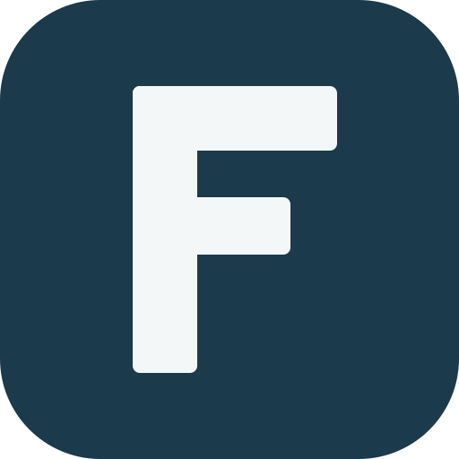

<div align="center">
  
  <h1>fskill</h1>
  <p><b>gofenix의 엔지니어링 습관을 당신의 스킬로</b></p>
  <p><a href="README.md">English</a> · <a href="README_CN.md">中文</a> · <a href="README_TW.md">繁體</a> · <a href="README_JA.md">日本語</a> · 한국어 · <a href="README_DE.md">Deutsch</a> · <a href="README_FR.md">Français</a></p>
  <a href="https://github.com/gofenix/fskill/actions/workflows/test.yml"></a>
  <a href="https://github.com/gofenix/fskill/stargazers"></a>
  <a href="https://github.com/gofenix/fskill/releases"></a>
  <a href="LICENSE"></a>
  <a href="https://twitter.com/Higofenix"></a>
</div>

<br/>

## 스킬 목록

fskill은 **9개의 슬림 워크플로우 + 8개의 `pstack` 스타일 엔지니어링 원칙 + 결정론적 스크립트**로 구성됩니다. 9개 스킬 모두 `/name`, `$name` 명시적 호출 또는 `/f-mode` 내에서만 실행되며 자동으로 동작하지 않습니다. [Waza](https://github.com/tw93/Waza), [Matt Pocock skills](https://github.com/mattpocock/skills), [pstack](https://github.com/cursor/plugins/tree/main/pstack)을 바탕으로 재구성했습니다.

| 스킬 | 묶음 | 역할 |
| :--- | :--- | :--- |
| [`/f-mode`](skills/f-mode/SKILL.md) | 경로 | 명시적으로 진입한 뒤 목표에 맞는 워크플로우와 공유 엔지니어링 원칙을 참고·선택합니다. |
| [`/think`](skills/think/SKILL.md) | 방향 정하기 | 구현 전 설계, 가치 판단, 범위 분류, `grill me` 압박 질문. |
| [`/hunt`](skills/hunt/SKILL.md) | 문제 찾기 | 런타임 증거 기반 근본 원인 분석 및 단일 가설 지표 개선. |
| [`/check`](skills/check/SKILL.md) | 확인 | diff/PR 검토, 릴리스 가치 판단, 프로젝트 감사, 사고 대장 검증. |
| [`/ui`](skills/ui/SKILL.md) | 화면 | 반 AI slop UI 제작과 실렌더링 스크린샷 검증. |
| [`/learn`](skills/learn/SKILL.md) [`/write`](skills/write/SKILL.md) | 읽고 쓰기 | URL/PDF 수집과 1차 자료 조사, AI 투 제거 및 릴리스 노트 작성. |
| [`/handoff`](skills/handoff/SKILL.md) [`/health`](skills/health/SKILL.md) | 다음에 쓰기 | 세션 인수인계, 에이전트 설정·hooks·MCP·토큰 도구 점검 및 규칙 슬림화. |

**8가지 엔지니어링 원칙 ([`rules/principles.md`](rules/principles.md), [`f-mode`](skills/f-mode/references/principles.md) 내장):** 추가 전 삭제 · 전제 검증 · 근본 원인 증명 · 실제 동작 검증 · 행위 테스트 · 수치 근거 제시 · 구조로 재발 방지 · 경계와 단방향 문 준수

`/f-mode`(Codex: `$f-mode`, 플러그인: `/fskill:f-mode`)로 시작한 뒤 평소처럼 요청하세요. 현재 대화에서 `/f-mode off`까지 자동 선택합니다. `/f-mode status`로 상태를 확인합니다. 직접 명령을 우선하며 f-mode는 유지됩니다. 새 대화에서는 꺼져 있습니다. 작업 권한은 바뀌지 않습니다. 전체 라우팅은 [skills/RESOLVER.md](skills/RESOLVER.md)를 참고하세요.

## 설치 방법

**Claude Code, Codex, Cursor 및 기타 에이전트**

```bash
npx skills add gofenix/fskill -a claude-code codex cursor -g -y
```

스킬은 공유 디렉터리인 `~/.agents/skills`에 저장됩니다. Claude Code는 심볼릭 링크로 연결되며, Codex, Cursor, Gemini CLI, Copilot, Amp, Kimi Code CLI 등 해당 디렉터리를 읽는 에이전트는 9개 워크플로우를 읽습니다. 독립 디렉터리를 사용하는 에이전트는 `-a` 뒤에 ID(예: `antigravity-cli`, `qwen-code`)를 지정하세요. 업데이트는 `npx skills update -g -y`로 실행합니다. AI 에이전트에게 직접 설치를 요청할 수도 있습니다:
> 다음 문서를 읽고 fskill를 설치해 줘: https://github.com/gofenix/fskill/blob/main/llms.txt

**호스트 플러그인 방식** (네임스페이스 포함: `/fskill:check`):

```bash
# Claude Code (업데이트: claude plugin update fskill)
/plugin marketplace add gofenix/fskill
/plugin install fskill@fskill

# Codex (업데이트: codex plugin marketplace upgrade fskill 후 codex plugin add fskill@fskill)
codex plugin marketplace add gofenix/fskill
codex plugin add fskill@fskill
```

**Claude Desktop**: [fskill.zip](https://github.com/gofenix/fskill/releases/latest/download/fskill.zip)을 다운로드한 뒤 Customize > Skills > "+" > Create skill에서 업로드합니다. 업데이트할 때는 카드에서 "..." > Replace를 선택해 최신 ZIP을 다시 업로드하세요.

**Pi**: `pi install npm:@gofenix/fskill`, 업데이트는 `pi update npm:@gofenix/fskill`로 실행합니다.

## 스킬 연계 워크플로우

f-mode 밖에서는 순서를 직접 정합니다. 각 스킬은 자기 결과를 내면 멈춥니다. 다음은 `/name` 또는 `$name` 으로 호출합니다.

**자주 쓰이는 워크플로우:**

- **새 기능 구현**: `/think`로 설계를 확정하고 승인 후 현재 에이전트가 구현한 뒤 `/check`로 검토·머지
- **버그 해결**: `/hunt`로 원인을 증명해 최소 수정한 뒤 `/check`로 변경 사항과 릴리스 증거 검토
- **리서치 및 작성**: `/learn`으로 자료를 정리하고 `/write`로 문장 다듬기

## 프로젝트 컨텍스트

fskill은 범용적인 엔지니어링 원칙과 스크립트만 제공합니다. `/check`는 런타임에 대상 저장소의 공개 정보(README, 패키지 파일, Makefile, CI 설정)와 작업 조건만을 읽으며 비공개 경로나 자격 증명, 토큰에는 접근하지 않습니다. 세부 패턴은 [`skills/check/references/review-patterns.md`](skills/check/references/review-patterns.md)와 [`skills/check/references/release-artifacts.md`](skills/check/references/release-artifacts.md)를 참고하세요.

## 추가 도구 및 규칙

curl URL은 최신 GitHub 릴리스 자산을 사용합니다. main의 최신 스크립트를 쓰려면 명령 앞에 `FSKILL_REF=main`을 지정하세요.

### 상태 표시줄

Claude Code용 미니멀 상태 표시줄: 컨텍스트 윈도우, 5시간 한도, 7일 한도를 사용량에 따라 색으로 표시하며, 진행 막대나 군더더기는 없습니다.

<div align="center">
  
</div>

```bash
(
  set -e
  FSKILL_STATUSLINE_SCRIPT="$(mktemp -t fskill-statusline.XXXXXX)"
  trap 'rm -f "$FSKILL_STATUSLINE_SCRIPT"' EXIT
  curl -fL https://github.com/gofenix/fskill/releases/latest/download/setup-statusline.sh -o "$FSKILL_STATUSLINE_SCRIPT"
  # 실행 전에 내용을 먼저 확인하세요: less "$FSKILL_STATUSLINE_SCRIPT"
  bash "$FSKILL_STATUSLINE_SCRIPT"
)
```

**Codex** 설정 (`~/.codex/config.toml`):

```toml
[tui]
status_line = ["model-with-reasoning", "current-dir", "context-used", "five-hour-limit", "weekly-limit"]
status_line_use_colors = true
```

Codex는 남은 한도를, 위의 Claude Code 상태 표시줄은 사용한 비율을 표시합니다(업스트림에서 아직 `five-hour-used` / `weekly-used`를 제공하지 않음).

### 선택적 규칙

선택적 규칙은 에이전트의 영구 지침에 설치하면 스킬을 호출하지 않을 때도 적용됩니다. fskill 스킬만 설치해서는 활성화되지 않습니다. 필요한 규칙을 복사해 실행하세요(Codex나 Antigravity에서는 `claude-code`를 `codex` 또는 `antigravity-cli`로 바꾸세요):

```bash
(
  set -e
  FSKILL_RULE_SCRIPT="$(mktemp -t fskill-rule.XXXXXX)"
  trap 'rm -f "$FSKILL_RULE_SCRIPT"' EXIT
  curl -fL https://github.com/gofenix/fskill/releases/latest/download/setup-rule.sh -o "$FSKILL_RULE_SCRIPT"
  # 실행 전에 내용을 먼저 확인하세요: less "$FSKILL_RULE_SCRIPT"

  # 영어 코칭: 프롬프트에 영어 실수가 있으면 끝에 짧은 😇 교정을 덧붙임
  bash "$FSKILL_RULE_SCRIPT" english claude-code

  # 안티패턴: 모든 스킬에 항상 적용되는 가드레일 (먼저 읽고 행동, 범위 확장 금지, 요청하지 않은 요약 금지)
  bash "$FSKILL_RULE_SCRIPT" anti-patterns claude-code

  # 라우팅 힌트: 9개 스킬 모두 명시적 호출 또는 /f-mode 내에서만 시작한다는 규칙
  bash "$FSKILL_RULE_SCRIPT" fskill-routing claude-code

  # 엔지니어링 원칙: 스킬 폴더를 늘리지 않고 적용하는 8가지 불변 원칙
  # Principles는 main 브랜치에서 사용할 수 있으며 아직 정식 릴리스에는 포함되지 않았습니다
  FSKILL_REF=main bash "$FSKILL_RULE_SCRIPT" principles claude-code

  # 명확한 일상 답변: 일관된 용어, 명시적인 조건, 불확실성 유지
  # Clarity는 main 브랜치에서 사용할 수 있으며 아직 정식 릴리스에는 포함되지 않았습니다
  FSKILL_REF=main bash "$FSKILL_RULE_SCRIPT" clarity claude-code
)
```

<div align="center">
  
</div>

[Clarity](rules/clarity.md)는 ASD-STE100의 명확한 글쓰기 원칙을 가져오지만, 통제 영어 문법을 강요하거나 문체를 바꾸지는 않습니다. 명령을 다시 실행하면 설치된 규칙이 업데이트되며, 그 뒤 새 세션을 시작하세요. Codex는 `~/.codex/AGENTS.md`에 표시된 블록을 추가하고, Claude Code와 Antigravity는 규칙 파일을 설치합니다. 다른 도구에서는 규칙을 해당 도구의 영구 사용자 지정 지침에 복사하세요.

## fskill를 만든 이유

fskill은 gofenix 자신의 스킬 모음입니다. [tw93/Waza](https://github.com/tw93/Waza)의 결정론적 스크립트와 [pstack](https://github.com/cursor/plugins/tree/main/pstack)의 원칙 중심 설계를 결합해 **9개의 경량 워크플로우**(`f-mode`, `think`, `hunt`, `check`, `ui`, `learn`, `write`, `handoff`, `health`)와 [`rules/principles.md`](rules/principles.md)의 8가지 원칙으로 정리했습니다.

9개 스킬 모두 `/name`, `$name` 명시적 호출 또는 `/f-mode`에서만 동작하며 자동으로 시작되지 않습니다.

## 삭제 방법

```bash
npx skills remove gofenix/fskill -g
rm -f ~/.claude/statusline.sh
rm -f ~/.claude/rules/english.md
rm -f ~/.claude/rules/anti-patterns.md
rm -f ~/.claude/rules/fskill-routing.md
rm -f ~/.claude/rules/principles.md
rm -f ~/.claude/rules/clarity.md
```

상태 표시줄을 설치했다면 `~/.claude/settings.json`에서 `statusLine` 항목도 삭제하세요. Claude Desktop에서는 Customize > Skills에서 fskill를 삭제하세요. Codex에 규칙을 설치했다면 `~/.codex/AGENTS.md`에서 fskill 표시 블록을 제거하세요. Antigravity에서는 `~/.gemini/antigravity-cli/rules/`에서 선택한 규칙 파일을 삭제하세요. 다른 도구에 복사한 규칙은 해당 도구의 사용자 지정 지침에서 제거하세요. 규칙을 제거한 뒤에는 새 세션을 시작하세요.

## 후원 안내

도움이 되었다면 저장소에 Star 를 누르거나 Issue 를 열어 주세요.

## 라이선스

MIT이며 UI 참고 자료에는 Apache-2.0 자료가 포함됩니다. [Waza](https://github.com/tw93/Waza), [Matt Pocock skills](https://github.com/mattpocock/skills), [pstack](https://github.com/cursor/plugins/tree/main/pstack)에 감사합니다. UI 방법은 [Impeccable](https://github.com/pbakaus/impeccable), [taste-skill](https://github.com/Leonxlnx/taste-skill), [apple-design](https://github.com/emilkowalski/skills)도 번역하고 재구성했습니다. 원본 버전, 변경 사항과 전체 라이선스는 루트 [LICENSE](LICENSE)에서 관리합니다. gofenix의 표기는 독자적인 추가 및 수정에, 원저자의 표기는 각 재사용 자료에 적용됩니다.
